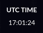

# calendar-web-viewer


The calendar viewer used to display the [priyom.org][] number station schedule.

* Scrolling reveals more future or past events depending on the direction.
* Stations are color-coded according to their emission type.
* Stations are linked to the respective website pages about them.
* Tested in Chrome, Firefox, Edge, and Internet Explorer.

The following closely associated component is also bundled:

| Name | Screenshot | Description |
| --- | --- | --- |
| **UTC clock** |  | Displays the current UTC time according to the system clock. Exists for UX reasons, as the viewer is currently capable of displaying events only in UTC, regardless of the user's time zone. |

## Getting started

The project is written in vanilla JavaScript, and contains no third-party
libraries apart from a few polyfills. Run `npm install && npx webpack` to create
a minified bundle.

The components are designed for creating themselves inside empty container
elements, rather than embedding using `<iframe>`. They can be used as follows:

```html
<div id="clock-container"></div>
<div id="calendar-container"></div>
<script src="viewer.js"></script> <!-- the bundle built by webpack -->
<script>
new UtcClock(document.getElementById('clock-container'));
new CalendarViewer(
  document.getElementById('calendar-container'),
  new GoogleCalendarSource('your API key', 'your calendar ID'));
</script>
```

`CalendarViewer` takes a data source as a constructor parameter.
`GoogleCalendarSource` fetches and parses events stored on a Google Calendar
instance, using the format described in its [source code][].

## License

The project itself is licensed under the GNU GPL version 3 or later.

The project is bundled together with [es6-promise][] and [whatwg-fetch][], both
available under the MIT license.

[priyom.org]: http://priyom.org
[source code]: src/google-calendar-source.js
[es6-promise]: https://github.com/stefanpenner/es6-promise
[whatwg-fetch]: https://github.com/github/fetch
