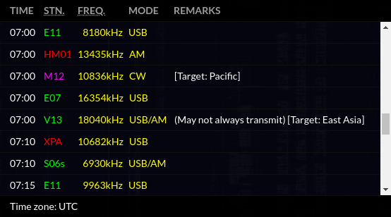

# calendar-web-viewer



The calendar viewer used to display the [priyom.org][] number station schedule.

* Scrolling reveals more future or past events depending on the direction.
* Stations are color-coded according to their emission type.
* Stations are linked to the respective website pages about them.
* Each radio frequency is printed on a distinct line.
* Tested on Chrome, Firefox, Edge, and Internet Explorer.

## Getting started

The viewer is written in vanilla JavaScript, and contains no third-party
libraries apart from a few polyfills. Run `npm install && npx webpack` to create
a minified bundle.

The viewer is designed for creating itself inside an empty container element,
rather than embedding using an `<iframe>`. It can be used as follows:

```html
<div id="container"></div>
<script src="viewer.js"></script> <!-- the bundle built by webpack -->
<script>
new CalendarViewer(
  document.getElementById('container'),
  new GoogleCalendarSource('your API key', 'your calendar ID'));
</script>
```

`GoogleCalendarSource` is a class that queries events hosted on a Google
Calendar, and parses them according to the distinctive Priyom event format.
Alternatively, the viewer may use any class that replicates [its API][] as the
data source instead.

## License

The project itself is licensed under the GNU GPL version 3 or later.

The project is bundled together with [es6-promise][] and [whatwg-fetch][], both
available under the MIT license.

[priyom.org]: http://priyom.org
[its API]: src/google-calendar-source.js
[es6-promise]: https://github.com/stefanpenner/es6-promise
[whatwg-fetch]: https://github.com/github/fetch
